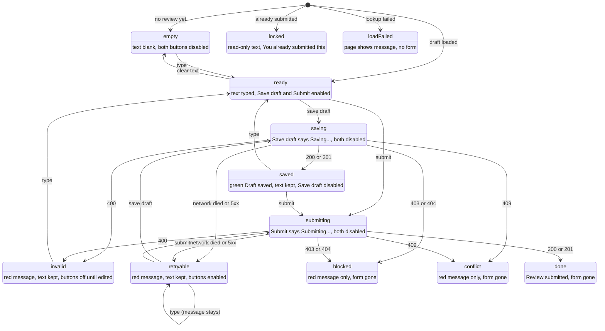

# Professors post assignments, students submit code and review each other through the API

## Why
The core classroom loop has to exist before anything smarter can sit on top of it: a professor posts an assignment, a student submits code, a classmate reviews it, and the author reads the feedback without learning who wrote it.

## Where it lives
- `packages/domain/src/` — Zod schemas (`schemas.ts`), queries (`assignments.ts`, `submissions.ts`, `reviews.ts`, `users.ts`), error mapping (`errors.ts`)
- `packages/domain/tests/peer-review.test.ts` — integration tests on PGlite
- `apps/web/app/api/` — route handlers: `me`, `assignments`, `assignments/[id]`, `assignments/[id]/submissions`, `submissions/[id]`, `submissions/[id]/reviews`, `reviews/[id]`
- `apps/web/lib/route.ts` — turns thrown errors into the standard error response
- `packages/db/prisma/` — `User`, `Assignment`, `Submission`, `ReviewPairing`, `Review` models; migration `0002_one_submission_one_pairing.sql`
- `apps/migrate/src/seed.ts` — demo users

## Behavior
Every handler follows the server entry ritual in [web.md](../web.md): identity from `currentUserId()`, Zod validation, a query scoped by that user, then error mapping. The client never sends a user id in the body.

| Method | Path | Who | Success |
|---|---|---|---|
| GET | `/api/me` | anyone with a user row | 200 current user |
| GET | `/api/assignments` | student: all assignments; professor: their own | 200 list, by due date |
| POST | `/api/assignments` | professor | 201 assignment owned by the caller |
| GET | `/api/assignments/{id}` | student: any; professor: their own | 200 |
| POST | `/api/assignments/{id}/submissions` | student | 201 submission |
| GET | `/api/assignments/{id}/submissions` | professor who owns it: all; student: only their own | 200 list |
| GET | `/api/assignments/{id}/review-candidates` | student | 200 anonymous submission ids not yet reviewed by caller |
| GET | `/api/submissions/{id}` | author, assignment's professor, or a student who reviewed it | 200 |
| POST | `/api/submissions/{id}/reviews` | student who is not the author | 201 review |
| POST | `/api/submissions/{id}/reviews/start` | student who is not the author | 201 resumable draft pairing |
| GET | `/api/submissions/{id}/reviews` | author and professor: all reviews; a reviewer: only their own | 200 list |
| GET | `/api/reviews/{id}` | reviewer, submission author, assignment's professor | 200 |
| PATCH | `/api/reviews/{id}` | student reviewer who owns a draft | 200 updated review |

Request bodies:

- Assignment: `{ "title": string, "description": string, "dueDate": ISO date }`
- Submission: `{ "code": string }`
- Review: `{ "content": string, "status": "DRAFT" | "SUBMITTED" }` (status defaults to `SUBMITTED`)
- Review patch: at least one of `{ "content": string, "status": "DRAFT" | "SUBMITTED" }`

Rules:

- The current identity must match a user row; otherwise 401 `UNAUTHENTICATED`.
- Wrong role for the action (student creating an assignment, professor submitting or reviewing) is 403 `FORBIDDEN_ROLE`.
- A student reviewing their own submission is 403 `SELF_REVIEW_NOT_ALLOWED`.
- Review candidates disclose only submission id and submission time. Starting a review creates an empty draft and pairing; only then can that reviewer read the code. Repeating the start request returns the existing draft, while a submitted review returns 409 `REVIEW_ALREADY_SUBMITTED`.
- A second submission by the same student for the same assignment is 409 `DUPLICATE_SUBMISSION`. A database unique index backs this check.
- A second review of the same submission by the same student is 409 `DUPLICATE_REVIEW`. A database unique index backs this check too.
- A reviewer updates their own draft with `PATCH /api/reviews/{id}`. The patch may change content, leave the status as `DRAFT`, or transition it to `SUBMITTED`; submitted reviews cannot be changed or returned to draft. Other users cannot patch the review.
- Submitting after `dueDate` is 409 `ASSIGNMENT_CLOSED`.
- Unknown ids, and resources the caller is not allowed to see, are 404 `NOT_FOUND`, never 403.
- Invalid bodies are 400 `VALIDATION_ERROR`; malformed JSON is 400 `INVALID_JSON`.
- Writing a review creates the `ReviewPairing` and the `Review` in one transaction.
- When the author reads a review, `reviewerId` is `null`. The professor and the reviewer see the real id.
- `submittedAt` on a review is `null` while the status is `DRAFT`.
- `submittedAt` records the time a draft transitions to `SUBMITTED`.
- Errors use one shape: `{ "error": { "code": "...", "message": "..." } }`. Unexpected errors are logged and return 500 `INTERNAL_ERROR` with no details.

## UI States


## Browser workflow

The home page is the local demo dashboard. It lets a professor switch among the seeded demo identities, create assignments, and inspect submissions and submitted reviews. Students can submit code, start a review from the anonymous candidate list, and read anonymous feedback on their own submission. Starting a review creates the pairing and an empty draft before the source is displayed; the reviewer can then save or submit through the existing review form. The identity selector is a development convenience and is disabled in production unless `ALLOW_DEV_IDENTITY` is explicitly set.

## Examples

| State / input | Behavior |
|---|---|
| `demo-user` (professor) POSTs an assignment due next week | 201, `professorId: "demo-user"` |
| `student-a` POSTs an assignment | 403 `FORBIDDEN_ROLE` |
| `student-a` submits, then submits again | 201, then 409 `DUPLICATE_SUBMISSION` |
| `student-a` submits to an assignment whose due date has passed | 409 `ASSIGNMENT_CLOSED` |
| `student-b` GETs `student-a`'s submission before reviewing it | 404 |
| `student-b` reviews `student-a`'s submission | 201; `student-b` can now GET the submission |
| `student-b` PATCHes their draft review | 200 with updated content; setting `status` to `SUBMITTED` records its submission time |
| `student-a` lists reviews on their submission | `reviewerId: null` on each |
| `student-a` reviews their own submission | 403 `SELF_REVIEW_NOT_ALLOWED` |
| A second professor GETs the first professor's assignment | 404 |
| `x-user-id: nobody` | 401 `UNAUTHENTICATED` |
| POST assignment with `"title": ""` | 400 `VALIDATION_ERROR` |

## Verify
Automated (no running services needed):

```bash
pnpm --filter @project/domain test    # or: pnpm test
```

Manual walkthrough against the local database. Start `pnpm dev`, run `pnpm db:seed` once, then in another terminal:

```bash
BASE=http://localhost:3000/api
JSON='Content-Type: application/json'

# Professor (demo-user is the default identity) creates an assignment
ASSIGNMENT=$(curl -s -X POST "$BASE/assignments" -H "$JSON" \
  -d '{"title":"Linked List","description":"Implement a singly linked list.","dueDate":"2099-10-15T23:59:00Z"}')
echo "$ASSIGNMENT"
ASSIGNMENT_ID=$(echo "$ASSIGNMENT" | python3 -c 'import sys,json; print(json.load(sys.stdin)["id"])')

# Student A submits
SUBMISSION=$(curl -s -X POST "$BASE/assignments/$ASSIGNMENT_ID/submissions" -H "$JSON" \
  -H 'x-user-id: student-a' -d '{"code":"public class LinkedList { }"}')
echo "$SUBMISSION"
SUBMISSION_ID=$(echo "$SUBMISSION" | python3 -c 'import sys,json; print(json.load(sys.stdin)["id"])')

# Student B reviews it
curl -s -X POST "$BASE/submissions/$SUBMISSION_ID/reviews" -H "$JSON" \
  -H 'x-user-id: student-b' \
  -d '{"content":"The null case is not handled before accessing next.","status":"SUBMITTED"}'; echo

# Student A tries to review their own submission: expect 403 SELF_REVIEW_NOT_ALLOWED
curl -s -X POST "$BASE/submissions/$SUBMISSION_ID/reviews" -H "$JSON" \
  -H 'x-user-id: student-a' -d '{"content":"Looks great!"}'; echo

# Student A reads the reviews: reviewerId is null
curl -s "$BASE/submissions/$SUBMISSION_ID/reviews" -H 'x-user-id: student-a'; echo

# The professor reads the same reviews: reviewerId is student-b
curl -s "$BASE/submissions/$SUBMISSION_ID/reviews"; echo

# Student A tries to create an assignment: expect 403 FORBIDDEN_ROLE
curl -s -X POST "$BASE/assignments" -H "$JSON" -H 'x-user-id: student-a' \
  -d '{"title":"x","description":"y","dueDate":"2099-01-01T00:00:00Z"}'; echo
```

Re-running the walkthrough creates a new assignment each time, so the duplicate checks don't get in the way. To start from empty, run `pnpm db:reset`, restart `pnpm dev`, then `pnpm db:seed`.

## Constraints & decisions
- **Identity comes from the auth seam, not the body.** Bodies never carry `professorId`, `studentId` or `reviewerId`; the dev stub supplies identity until real auth replaces it ([ADR-0003](../../adr/0003-dev-identity-stub.md), [auth.md](../auth.md)).
- **No user creation endpoint.** Users come from the seed script for now; the auth spec says first sign-in creates the user.
- **No courses.** Students can see every assignment. Course scoping comes with a courses spec.
- **Reviewers pick submissions themselves.** There is no pairing algorithm yet, so writing a review creates the pairing. A student can only find a submission id if someone gives it to them; the list endpoint only shows their own.
- **Roles and review status are stored as text**, matching the reviewed `0001_init` migration. Zod enforces the allowed values at the edge.
- **Code is stored as text** in `Submission.codeFileContent`. No file uploads, and code is never executed.
- Queries live in `packages/domain` and are imported only by the web app ([ADR-0009](../../adr/0009-domain-web-only.md)).

## Out of scope
- Inline comments, rubrics, grading (`Grade` table exists but has no API yet) — no spec yet
- Automatic anonymous reviewer pairing — no spec yet
- AI shadow reviews and static analysis (will run in `apps/worker`) — no spec yet
- Real sign-in — [auth.md](../auth.md)
- Review UI pages — no spec yet
